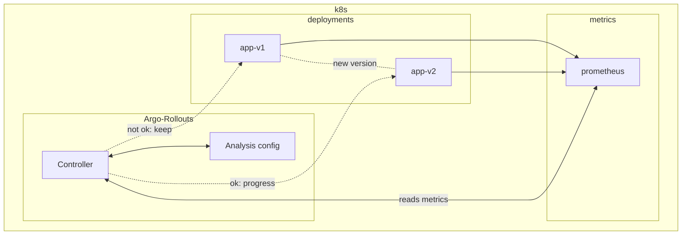

# Argo Rollouts

`Argo-Rollouts` is a controller from `ArgoCD` that provides ways to performa analysis on deployments, and progress or rollback those based on metrics and statistics.


The problems `Argo-Rollouts` solves:

* Progressive deployment of a single version for your deployments, but only after some proof / analysis that the new version satisfies the criteria.
* We can't rely only on simple health checks (Readiness on k8s for example) to take the decision, as in some cases this is used as a measure to progress deployments.
    * With `Argo-Rollouts` we can make it based on metrics from `prometheus` and acccurate measure success rates, latency and others.
* As explained above we have the hability to check external metrics that can give a more accurate view about the new version health. 

For more info we check the [`Argo-Rollouts page`](https://argo-rollouts.readthedocs.io/en/stable/).

# Setup

This repo is to explore two rollout deployment techniquies: `Blue-Green` and `Canary`.

The repo will contain simple setups for both scenarios.



Components:

* `Argo-Rollouts`:
    * `Controller`:
    * `Analysis`: 
* `Deployments`:
    * `App v1`:
    * `App v2`:
* `Prometheus`: 

# Building the image

First version of the app:

```bash
podman build . -t app-argo-rollouts:v1.0.0
```

I am using a remote podman and minikube cluser on another machine, so I am able to push the build there as well, so it's within the same environment as the minikube I'm using:

```bash
podman build --connection fsouza1 build . -t app-argo-rollouts:v1.0.0
```

For the second version we will be randomly waiting on returning a response.

Ucomment [line 7](./app/main.go#7), it's the import for the `time` go package.

And uncomment [line 78](./app/main.go#78), to add the `time.Sleep` call.

Now build a second version of the image for our new deployment:

```bash
podman build . -t app-argo-rollout:v2.0.0
```

Checking the kustomize output with `kubeconform`:

```bash
cd k8s-deployments/
kustomize build . | kubeconform -strict -summary
```

```bash
kustomize build . | kubeconform -strict -summary
Summary: 2 resources found parsing stdin - Valid: 2, Invalid: 0, Errors: 0, Skipped: 0
```

Appllying changes with kustomize (change the image tag: 

```bash
cd k8s-deployments/ 
kustomize edit set image myregistry/myapp:v1.4.3
kubectl apply -k .
```

# Installation

Prometheus deployment to minikube: 

```bash

```

In order to install the controllers for `Argo-Rollouts`:

```bash
kubectl create namespace argo-rollouts
kubectl apply -n argo-rollouts -f https://github.com/argoproj/argo-rollouts/releases/latest/download/install.yaml
```

# Blue-Green

# Canary
