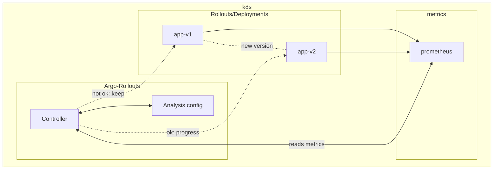

# Argo Rollouts

`Argo-Rollouts` is a controller from `ArgoCD` that provides ways to performa analysis on deployments, and progress or rollback those based on metrics and statistics.


The problems `Argo-Rollouts` solves:

* Progressive deployment of a single version for your deployments, but only after some proof / analysis that the new version satisfies the criteria.
* We can't rely only on simple health checks (Readiness on k8s for example) to take the decision, as in some cases this is used as a measure to progress deployments.
    * With `Argo-Rollouts` we can make it based on metrics from `prometheus` and acccurate measure success rates, latency and others.
* As explained above we have the hability to check external metrics that can give a more accurate view about the new version health. 

For more info we check the [`Argo-Rollouts page`](https://argo-rollouts.readthedocs.io/en/stable/).

# Setup

This repo is to explore two rollout deployment techniquies: `Blue-Green` and `Canary`.

The repo will contain simple setups for both scenarios.



Components:

* `Argo-Rollouts`: has different components to monitor `Rollouts`, and make it's progression using `Canary`, `Blue-Green` strategies.
    * `Controller`: main component on `argo-rollouts`, monitoring all events and reacts when a `Rollout` resource is changed.
    * `Analysis`: we will be creating `CRDs` like `AnalysisTemplate` and `AnalysisRun`, it does the connection with the `Rollout` resource and the metrics provider, in our case prometheus. 
* `Rollout/Deployments`: It's a `CRD` from `argo-rollouts`, very similar to a `Deployment`, with some additional keys we will need to configure as well to work. As explained above the main link for the controller to continue monitoring `rollouts` is the `AnalysisTemplate` or `AnalysisRun` `CRDs`.
    * `App v1`: first version of the `Rollout`.
    * `App v2`: second version of the `Rollout`.
* `Prometheus`: metric provider for our `argo-rollout`. 

## Building the image

First version of the app:

```bash
podman build . -t app-argo-rollouts:v1.0.0
```

I am using a remote podman and minikube cluser on another machine, so I am able to push the build there as well, so it's within the same environment as the minikube I'm using:

```bash
podman build --connection fsouza1 build . -t app-argo-rollouts:v1.0.0
```

For the second version we will be randomly waiting on returning a response.

Ucomment [line 7](./app/main.go#7), it's the import for the `time` go package.

And uncomment [line 78](./app/main.go#78), to add the `time.Sleep` call.

Now build a second version of the image for our new deployment:

```bash
podman build . -t app-argo-rollout:v2.0.0
```


# Installation

## Prometheus deployment to minikube

I'll use the community maintained helm chart for prometheus for this installation.

Check their [repo](https://github.com/prometheus-community/helm-charts) in order to customize your own deployment.

```bash
kubectl create namaspace prometheus
helm add prometheus-community https://prometheus-community.github.io/helm-charts
helm -n prometheus install prometheus prometheus-community/prometheus
```

Check for the prometheus components:

```bash
kubectl -n prometheus get po
```

```
NAME                                                 READY   STATUS    RESTARTS   AGE
prometheus-alertmanager-0                            2/2     Running   0          4m26s
prometheus-kube-state-metrics-798fb7d7b8-ttsdp       1/1     Running   0          4m26s
prometheus-prometheus-node-exporter-2fxpk            1/1     Running   0          4m26s
prometheus-prometheus-pushgateway-79f99dd8bb-x5fxm   1/1     Running   0          4m26s
prometheus-server-69bf7bcf78-zhs5l                   2/2     Running   0          4m26s
```

And you can check for the whole release and versions installed through helm:

```bash
helm -n prometheus list
NAME            NAMESPACE       REVISION        UPDATED                                 STATUS          CHART                   APP VERSION
prometheus      prometheus      1               2026-09-27 17:46:04.786285 +0200 CEST   deployed        prometheus-29.34.0      v3.15.0
```

You can `port-forward` and access the prometheus server with the following: **Ps: this is shown during the helm installation as well.**

```bash
export POD_NAME=$(kubectl get pods --namespace prometheus -l "app.kubernetes.io/name=prometheus,app.kubernetes.io/instance=prometheus" -o jsonpath="{.items[0].metadata.name}")
kubectl --namespace prometheus port-forward $POD_NAME 9090
```

And here's the main page on prometheus, where you can test and check the queries we will be using for our `argo-rollouts` scenarios:


## Argo-Rollouts installation

In order to install the controllers for `Argo-Rollouts`:

```bash
kubectl create namespace argo-rollouts
kubectl apply -n argo-rollouts -f https://github.com/argoproj/argo-rollouts/releases/latest/download/install.yaml
```

## Rollout / Deployment creation

I'll be using `kustomize` and `kubeconform` to install and lint the resources.

The requirements for this step is to have at least the [`Argo-Rollouts` installation done first](#argo-rollouts-installation) as this depends on the `Rollout` CRD installation.

I'll be including examples on how to have a `Rollout` `CRD` referencing a deployment as well.

The main thing is that the `Rollout` `CRD` is anyway creating a `Deployment` resource behind the scenes too.

But to avoid any miss-configuration with the `strategy` for a `Deployment` and a `Rollout`, when using `Argo-Rollouts` it's better to use the later.

Checking the kustomize output with `kubeconform`:

**Ps: `kubeconform` needs the schema URL as below for `CRDs`.**

```bash
cd k8s-deployments/
kustomize build . | kubeconform \
  -schema-location default \
  -schema-location 'https://raw.githubusercontent.com/CustomResourceDefinition/catalog/main/schema/argoproj.io/rollout_v1alpha1.json' \
  -strict -summary
```

```bash
Summary: 2 resources found parsing stdin - Valid: 2, Invalid: 0, Errors: 0, Skipped: 0
```

Appllying changes with kustomize (change the image tag: 

```bash
cd k8s-deployments/ 
kustomize edit set image <registry/image:tag>
kubectl apply -k .
```
# Blue-Green

# Canary
