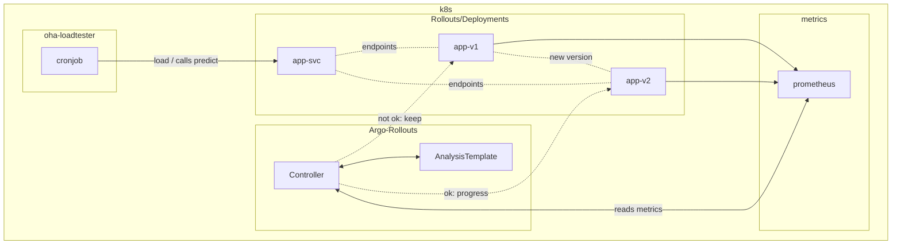
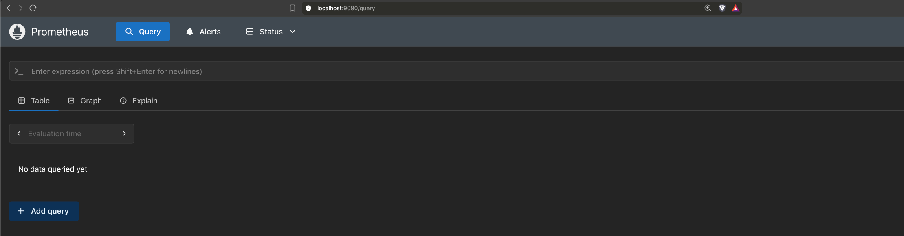

# Argo Rollouts

`Argo-Rollouts` is a controller from `ArgoCD` that provides ways to performa analysis on deployments, and progress or rollback those based on metrics and statistics.

The problems `Argo-Rollouts` solves:

* Progressive deployment of a single version for your deployments, but only after some proof / analysis that the new version satisfies the criteria.
* We can't rely only on simple health checks (Readiness on k8s for example) to take the decision, as in some cases this is used as a measure to progress deployments.
    * With `Argo-Rollouts` we can make it based on metrics from `prometheus` and acccurate measure success rates, latency and others.
* As explained above we have the hability to check external metrics that can give a more accurate view about the new version health. 

For more info we check the [`Argo-Rollouts page`](https://argo-rollouts.readthedocs.io/en/stable/).

# Setup

This repo is to explore two rollout deployment techniquies: `Blue-Green` and `Canary`.

The repo will contain simple setups for both scenarios.



Components:

* `Argo-Rollouts`: has different components to monitor `Rollouts`, and make it's progression using `Canary`, `Blue-Green` strategies.
    * `Controller`: main component on `argo-rollouts`, monitoring all events and reacts when a `Rollout` resource is changed.
    * `Analysis`: we will be creating `CRDs` like `AnalysisTemplate` and `AnalysisRun`, it does the connection with the `Rollout` resource and the metrics provider, in our case prometheus. 
* `Rollout/Deployments`: It's a `CRD` from `argo-rollouts`, very similar to a `Deployment`, with some additional keys we will need to configure as well to work. As explained above the main link for the controller to continue monitoring `rollouts` is the `AnalysisTemplate` or `AnalysisRun` `CRDs`.
    * `App v1`: first version of the `Rollout`.
    * `App v2`: second version of the `Rollout`.
* `Prometheus`: metric provider for our `argo-rollout`. 

## Building the images

First version of the app:

```bash
podman build . -t app-argo-rollouts:v1.0.0
```

I am using a remote podman and minikube host, so I am able to push the build to the remote host:

```bash
podman --connection <remote-host> build . -t app-argo-rollouts:v1.0.0
```

For the version `v2.0.0` we will be randomly wait / pause for a few seconds on requests:

1. Ucomment [line 16](./app/main.go#16), it's the import for the `time` go package.
2. And uncomment [line 120](./app/main.go#120), to add the `time.Sleep` call.

Now build a second version of the image for our new deployment:

```bash
podman build . -t app-argo-rollout:v2.0.0
```

For version `v2.0.1`, our fix to the version above we will remove the wait, and plus remove the calculation we have on generating the response, just using a constant instead.

This is mainly to just get a bit more time on returning the responses and to garaantee we will be on the same `SLO` or bettter than the previous deployment.

There are several ways to make the image available to your `minikube` instance (on podman running as another container and it can't reach the registry), but on my simple setup I would rather just share the image by `saving` a tar file and then `loading` into minikube:

1. Comment both lines for the `v2.0.0` above, again [line 16](./app/main.go#15) and [line 120](./app/main.go#120).
2. Now comment the `mrand` we call for generating the reponse at [line 12](./app/main.go#12) and [line 115](./app/main.go#115), and uncomment [line 117](./app/main.go#117).

Again build the new image:

```bash
podman build . -t app-argo-rollout:v2.0.0
```

```bash
podman save localhost/app-argo-rollouts:v1.0.0 -o app-argo-rollouts-v100.tar
```

If you want to save multiple images use the `--multi-image-archive` or `-m` option, otherwise the other names in the list will be load as only tags for the image being saved:

```bash
podman save -m localhost/app-argo-rollouts:v1.0.0 localhost/app-argo-rollouts:v2.0.0 localhost/app-argo-rollouts:v2.0.1 -o app-argo-rollouts.tar
Copying blob f4aefcbfe669 done   |
Copying blob f24db9c6334e done   |
Copying config 43718e2f44 done   |
Writing manifest to image destination
Copying blob f4aefcbfe669 skipped: already exists
Copying blob e3999601d03b done   |
Copying config 3b675aeb01 done   |
Writing manifest to image destination
Copying blob f4aefcbfe669 skipped: already exists
Copying blob d745a710d55d done   |
Copying config a0c911041d done   |
Writing manifest to image destination
```

```bash
minikube image load app-argo-rollouts-v100.tar
```

**With the 3 images now at hand we can now proceed with the rollouts, as mainly the rollouts will be pushing new hashes due to the image change.**

# Installation

## oha Loadtests

I'll be using either [`oha`](https://rustutils.com/tools/oha/) or [`hey`](https://cli.wiki/hey---HTTP-Load-Testing-Tool-Guide#overview) as my loadtest tool.

`oha` is `rust` and it gives you a execution summary and histograms, and it looks a bit nicer in terms of output and live tracking the executions.

For go enjoyers there's `hey`, and it can be installed and embedded with any go application.

`hey` brings a summary and histogram of execution as well, but with a simple interface.

I'm seeing `hey` as an alternative, but mainly I'll be using `oha`, as the installation, help is ready to use on macs, but might try `hey` on the server machine I'm deploying everything as well.

`oha` installation:

```bash
brew install oha
```

For more info on both tools check the links above.

Example request:

```bash
oha http://localhost:5001/predict \
  -m POST \
  -H "Content-Type: application/json" \
  -Z ./oha-loadtest/requests.ndjson \
  -q 10 \
  -z 5m \
  -c 10 \
  --no-tui
```

`oha` will be deployed as a `CronJob` in order to trigger requests to the setup.

**If we `port-forward` the k8s service and push requests to it, it pushes requests to a single pod, as it's mainly just like a helper to get to pick an endpoint or pod, so use it to validate your app, but not as a load-test, as requests won't be distributed to different pods.**

**Ps: Services are only doing round-robin calls to the underline pods / endpoints, so there's no rule by default that looks if a pod is overloaded or not.**

Check the [`README`](./oha-loadtest/README.md) for more details on the image, and build it using the same techniques as showed above for the app images, and make it available / load to your `minikube` / `k8s` cluster.

## Prometheus deployment to minikube

I'll use the community maintained helm chart for prometheus for this installation.

Check their [repo](https://github.com/prometheus-community/helm-charts) in order to customize your own deployment.

```bash
kubectl create namaspace prometheus
helm add prometheus-community https://prometheus-community.github.io/helm-charts
helm -n prometheus install prometheus prometheus-community/prometheus
```

Check for the prometheus components:

```bash
kubectl -n prometheus get po
```

```
NAME                                                 READY   STATUS    RESTARTS   AGE
prometheus-alertmanager-0                            2/2     Running   0          4m26s
prometheus-kube-state-metrics-798fb7d7b8-ttsdp       1/1     Running   0          4m26s
prometheus-prometheus-node-exporter-2fxpk            1/1     Running   0          4m26s
prometheus-prometheus-pushgateway-79f99dd8bb-x5fxm   1/1     Running   0          4m26s
prometheus-server-69bf7bcf78-zhs5l                   2/2     Running   0          4m26s
```

And you can check for the whole release and versions installed through helm:

```bash
helm -n prometheus list
NAME            NAMESPACE       REVISION        UPDATED                                 STATUS          CHART                   APP VERSION
prometheus      prometheus      1               2026-09-27 17:46:04.786285 +0200 CEST   deployed        prometheus-29.34.0      v3.15.0
```

You can `port-forward` and access the prometheus server with the following: **Ps: this is shown during the helm installation as well.**

```bash
export POD_NAME=$(kubectl get pods --namespace prometheus -l "app.kubernetes.io/name=prometheus,app.kubernetes.io/instance=prometheus" -o jsonpath="{.items[0].metadata.name}")
kubectl --namespace prometheus port-forward $POD_NAME 9090
```

And here's the main page on prometheus, where you can test and check the queries we will be using for our `argo-rollouts` scenarios:



## Argo-Rollouts installation

In order to install the controllers for `Argo-Rollouts`:

```bash
kubectl create namespace argo-rollouts
kubectl apply --server-side --force-conflicts -n argo-rollouts -f https://github.com/argoproj/argo-rollouts/releases/latest/download/install.yaml
```

**PS: It includes already the `CRDs`/**

## Rollout / Deployment creation

I'll be using `kustomize` and `kubeconform` to apply and lint the resources.

**Work with both will make it easier as well to template the same resources by just passing different `overlays` for both scenarios.**

The requirements for this step is to have at least the [`Argo-Rollouts` installation done first](#argo-rollouts-installation) as this depends on the `Rollout` CRD installation.

I'll be including examples on how to have a `Rollout` `CRD` referencing a deployment as well.

The main thing is that the `Rollout` `CRD` is anyway creating a `Deployment` resource behind the scenes too.

But to avoid any miss-configuration with the `strategy` for a `Deployment` and a `Rollout`, when using `Argo-Rollouts` it's better to use the later.

Checking the kustomize output with `kubeconform`:

**Ps: `kubeconform` needs the schema URL as below for `CRDs`.**

```bash
cd k8s-deployments/
kustomize build --load-restrictor LoadRestrictionsNone ./overlays/canary | kubeconform \
  -schema-location default \
  -schema-location 'https://raw.githubusercontent.com/datreeio/CRDs-catalog/main/{{.Group}}/{{.ResourceKind}}_{{.ResourceAPIVersion}}.json' \
  -strict -summary
```

```bash
Summary: 5 resources found parsing stdin - Valid: 5, Invalid: 0, Errors: 0, Skipped: 0
```

Appllying changes with kustomize (change the image tag: 

```bash
cd k8s-deployments/ 
kustomize edit --load-restrictor LoadRestrictionsNone ./overlays/canary set image <registry/image:tag>
kustomize build --load-restrictor LoadRestrictionsNone overlays/canary | kubectl apply -f -
```

```bash
namespace/app-argo-rollouts created
service/canary-argo-rollouts-deployment-http created
service/canary-argo-rollouts-deployment-metrics created
rollout.argoproj.io/canary-argo-rollouts-deployment created
```

If you want to clean all resources there the same `kustomize build` can be used with delete now:

```bash
cd k8s-deployments/
kustomize build --load-restrictor LoadRestrictionsNone overlays/canary | kubectl delete --force=true -f -
```

# Kustomize setup

I'm build the following as the structure for managing the deployments with `kustomize`:

```text
k8s-deployments/
   ├─ overlays/                         - all patches / overwrites done by kustomize to the app-argo-rollouts.yaml
   │  └─ canary/                        - canary patches / overwrites
   │     ├─ cronjob-patch.yaml          - CronJob patch with the query and other aspects of the k8s CronJob
   │     ├─ kustomization.yaml          - main canary kustomization.yaml pointing to the patch files and main file
   │     └─ strategy-patch.yaml         - the canary strategy patch for the rollout
   └─ app-argo-rollouts.yaml            - main yaml with all resource definitions
```

This structure makes it simpler to change aspects of the resources, as for an example I'll be doing the same exercise for `blue-green` but with different customizations.

`Kustomize` is template free, not like `helm`, and it's simpler when dealing with resources you don't need to distribute.

You can use both though, like patch a 3rd party `helm chart` that lacks something you actually need.

But I didn't want any `full release` control of the resources in this case, just `argo-rollouts` controlling the rollouts is enough for this exercise.

I might return anyway in the future to make a `helm` chart, not for distribution but ony for the sacke of testing it together with `kustomize`.

More references: 

* <a href="https://kubectl.docs.kubernetes.io/references/kustomize/kustomization/helmcharts/" target="_blank">kustomize enable-helm</a>
* 


# Canary

For the whole exercise to work the `oha-loadtester` will constantly generate traffic with little to not gaps.

My plan of deployment is the following:

1. First rollout with stable version `v1.0.0`.
2. Let's do a new rollout setting the image to the new app `v2.0.0`.
    1. As it's a canary deployment we can see new pods for the new rollout brought up after each step of the rollout.
    2. Each step brings more pods up, and after step 2 it's when our `AnalysisTemplate` is triggered, but the condition is that more than just a single check of the metrics is done, so multiple failures have to show that the new deployment is actually slower than the previous one.
    3. Rollout here should be rolled back, as our `AnalysisTemplate` will fail, as our `SLO` will not hit the target, so new version is slower than the stable one.
3. Now it comes the fix with new tag `v2.0.1`, so a new image set for the app.
    1. Now the `SLO` will be better or equal to the version `v1.0.0`, so rollout should progress. 

**Ps: I'm not taking into consideration if the app had any changes in terms of features, that forces it to be changed, like a change on how the calculation does, and anyway in cases like this you can force `argo-rollouts` to anyway proceed with the rollout even though the analysis have failed.**

## AnalysisTamplate

In order for the rollouts to progress it has to pass the `AnalysisTemplate` called `latency`.

The analysis template is based on the `prometheus` metric `app_request_duration_seconds_bucket`:

```promql
sum(rate(app_request_duration_seconds_bucket{le="0.5",app="{{args.app-name}}",endpoint="{{args.predict-endpoint}}",rollouts_pod_template_hash="{{args.canary-hash}}"}[5m]))
/
sum(rate(app_request_duration_seconds_bucket{le="+Inf",app="{{args.app-name}}",endpoint="{{args.predict-endpoint}}",rollouts_pod_template_hash="{{args.canary-hash}}"}[5m]))
```

So here's what the query results:

* Analysis the min `SLO` for the new `canary-hash` rollout metrics for the `bucket` `le="0.5"`:
    * All requests should be below 0.5s or lower.
    * A decrease in `le="0.5"` can just mean fewer requests overall, so the absolute bucket rate isn't a reliable signal. What matters is the proportion of requests under a threshold. If `le="0.5"` drops while `le="+Inf"` doesn't, there are more executions above `0.5`.

Here's the main definition of the `AnalysisTemplate`:

```yaml
apiVersion: argoproj.io/v1alpha1
kind: AnalysisTemplate
metadata:
  name: latency
spec:
  args:
  - name: app-name
  - name: predict-endpoint
  - name: canary-hash
  metrics:
  - name: app_request_duration_seconds_bucket
    interval: 1m
    # NOTE: prometheus queries return results in the form of a vector.
    # So it is common to access the index 0 of the returned array to obtain the value
    successCondition: len(result) > 0 && result[0] >= 0.95
    failureLimit: 5 
    provider:
      prometheus:
        address: http://prometheus-server.prometheus.svc.cluster.local
        query: |
          sum(rate(app_request_duration_seconds_bucket{le="0.5",app="{{args.app-name}}",endpoint="{{args.predict-endpoint}}",rollouts_pod_template_hash="{{args.canary-hash}}"}[5m]))
          /
          sum(rate(app_request_duration_seconds_bucket{le="+Inf",app="{{args.app-name}}",endpoint="{{args.predict-endpoint}}",rollouts_pod_template_hash="{{args.canary-hash}}"}[5m]))
```

By he definiion we see:
* The query and the whole defintion we described above for how he analysis is done and what's analyised.
* The `failureLimit` is set to 8, so failures < 9, rollouts won't progress.

**The same analysis does not run on the first rollout deployment, but you can run it as well by creating an `AnalysisRun` instead with the same queries as above and run it manually.**

As an additonal test I've included an analysis template to check the counts of response status codes, so if we have `5**` response status codes, it means that there's some issue with the rollout, so don't progress.

Here's the `AnalysisTemplate` defintion:


```yaml
apiVersion: argoproj.io/v1alpha1
kind: AnalysisTemplate
metadata:
  name: errors-new-rollout
spec:
  args:
  - name: app-name
  - name: predict-endpoint
  - name: canary-hash
  metrics:
  - name: app_http_requests_total
    interval: 1m
    successCondition: len(result) == 0 || result[0] == 0
    failureLimit: 5 
    provider:
      prometheus:
        address: http://prometheus-server.prometheus.svc.cluster.local
        query: |
          sum(rate(app_http_requests_total{status_code=~"5.*",app="{{args.app-name}}",endpoint="{{args.predict-endpoint}}",rollouts_pod_template_hash="{{args.canary-hash}}"}[5m])) or vector(0)
```

This template will be probably used as well for the `Blue-Green` rollout strategy. 

# Blue-Green

`TODO`
