# Argo Rollouts

`Argo-Rollouts` is a controller from `ArgoCD` that provides a way to perform analysis on deployments based on metrics, or any custom inputs, and it decides based on the results to progress with the new version. 

The problems `Argo-Rollouts` solves:

* Progressive deployment of a single version for your deployments, but only after some proof / analysis that the new version satisfies the criteria.
* We can't rely only on simple health checks (Readiness on k8s for example) to take the decision, as in some cases this is used as a measure to progress deployments.
    * With `Argo-Rollouts` we can make it based on metrics from `prometheus` and acccurate measure success rates, latency and others.
* As explained above we have the hability to check external metrics that can give a more accurate view about the new version health. 

For more info we check the [`Argo-Rollouts page`](https://argo-rollouts.readthedocs.io/en/stable/).

# Setup

This repo is explores two rollout deployment strategies: `Blue-Green` and `Canary`.

**Ps: `Blue-Green` will be coming in the near future.**

The repo will contain a simple setup for both scenarios.

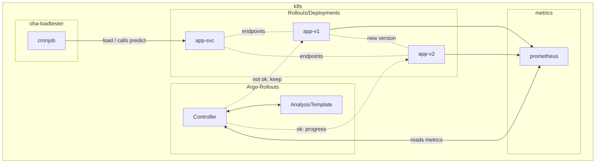

Components:

* `Argo-Rollouts`: has different components to monitor `Rollouts`, and make it's progression using `Canary`, `Blue-Green` strategies.
    * `Controller`: main component on `argo-rollouts`, monitoring all events and reacts when a `Rollout` resource is changed.
    * `Analysis`: we will be creating `CRDs` like `AnalysisTemplate` and `AnalysisRun`, it does the connection with the `Rollout` resource and the metrics provider, in our case `prometheus`. 
* `Rollout/Deployments`: It's a `CRD` from `argo-rollouts`, very similar to a `Deployment`, with some additional keys we will need to configure as well to work. As explained above the main link for the controller to continue monitoring `rollouts` is the `AnalysisTemplate` or `AnalysisRun` `CRDs`.
    * `App v1`: first version of the `Rollout`.
    * `App v2`: second version of the `Rollout`.
* `Prometheus`: metric provider for our `argo-rollout`. 

## Building the images

First version of the app:

```bash
podman build . -t app-argo-rollouts:v1.0.0
```

I am using a remote podman and minikube host, so I am able to push the build to the remote host:

```bash
podman --connection <remote-host> build . -t app-argo-rollouts:v1.0.0
```

For the version `v2.0.0` we will be randomly waiting / pausing for a few seconds on requests:

1. Ucomment [line 16](./app/main.go#16), it's the import for the `time` go package.
2. And uncomment [line 120](./app/main.go#120), to add the `time.Sleep` call.

Now build a second version of the image for our new deployment:

```bash
podman build . -t app-argo-rollout:v2.0.0
```

For version `v2.0.1`, our fix to the version above, we will remove the wait and the calculation we have on generating the response, just using a constant instead.

This is mainly to just get a bit more time on returning the responses and to garaantee we will be on the required `SLO`.

There are several ways to make the image available to your `minikube` instance (on podman running as another container and it can't reach the registry), but on my simple setup I would rather just share the image by `saving` a tar file and then `loading` into minikube:

1. Comment both lines for the `v2.0.0` above, again [line 16](./app/main.go#15) and [line 120](./app/main.go#120).
2. Now comment the `mrand` we call for generating the reponse at [line 12](./app/main.go#12) and [line 115](./app/main.go#115), and uncomment [line 117](./app/main.go#117).

Again build the new image:

```bash
podman build . -t app-argo-rollout:v2.0.0
```

```bash
podman save localhost/app-argo-rollouts:v1.0.0 -o app-argo-rollouts-v100.tar
```

If you want to save multiple images use the `--multi-image-archive` or `-m` option, otherwise the other names in the list will be load as only tags for the image being saved:

```bash
podman save -m localhost/app-argo-rollouts:v1.0.0 localhost/app-argo-rollouts:v2.0.0 localhost/app-argo-rollouts:v2.0.1 -o app-argo-rollouts.tar
Copying blob f4aefcbfe669 done   |
Copying blob f24db9c6334e done   |
Copying config 43718e2f44 done   |
Writing manifest to image destination
Copying blob f4aefcbfe669 skipped: already exists
Copying blob e3999601d03b done   |
Copying config 3b675aeb01 done   |
Writing manifest to image destination
Copying blob f4aefcbfe669 skipped: already exists
Copying blob d745a710d55d done   |
Copying config a0c911041d done   |
Writing manifest to image destination
```

```bash
minikube image load app-argo-rollouts.tar
```

**With the 3 images now we can now proceed with the rollouts, as mainly the rollouts will be pushing new hashes due to the image change.**

# Installation

## oha Loadtests

I'll be using either [`oha`](https://rustutils.com/tools/oha/) or [`hey`](https://cli.wiki/hey---HTTP-Load-Testing-Tool-Guide#overview) as my `load-test` tools.

`oha` is developed in `rust` and it gives you a execution summary and histograms and live tracking of the executions.

For go enjoyers there's `hey`, and it can be installed and embedded with any go application.

`hey` brings a summary and histogram of execution too, but with a simpler interface.

I'm putting `hey` here as an alternative, but mainly I'll be using `oha`, as the binary installation is simpler to embed into a Docker container image.

The binary on mac is simple to install too, and it contains a man / help page to check arguments.

`oha` installation:

```bash
brew install oha
```

For more info on both tools check the links above.

Example request:

```bash
oha http://localhost:5001/predict \
  -m POST \
  -H "Content-Type: application/json" \
  -Z ./oha-loadtest/requests.ndjson \
  -q 10 \
  -z 5m \
  -c 10 \
  --no-tui
```

`oha` will be deployed as a `CronJob` in order to trigger requests to the setup.

**If we `port-forward` the k8s service and push requests to it, it pushes requests to a single pod, as it's mainly just like a helper to get to pick an endpoint or pod, so use it to validate your app, but not as a load-test, as requests won't be distributed to different pods.**

**Ps: Services are only doing round-robin calls to the underline pods / endpoints, so there's no rule by default that looks if a pod is overloaded or not.**

Check the [`README`](./oha-loadtest/README.md) for more details on the image, and build it using the same techniques as showed above for the app images, and make it available / load to your `minikube` / `k8s` cluster.

## Prometheus deployment to minikube

I'll use the community maintained helm chart for prometheus for this installation.

Check their [repo](https://github.com/prometheus-community/helm-charts) in order to customize your own deployment.

```bash
kubectl create namaspace prometheus
helm add prometheus-community https://prometheus-community.github.io/helm-charts
helm -n prometheus install prometheus prometheus-community/prometheus
```

Check for the prometheus components:

```bash
kubectl -n prometheus get po
```

```
NAME                                                 READY   STATUS    RESTARTS   AGE
prometheus-alertmanager-0                            2/2     Running   0          4m26s
prometheus-kube-state-metrics-798fb7d7b8-ttsdp       1/1     Running   0          4m26s
prometheus-prometheus-node-exporter-2fxpk            1/1     Running   0          4m26s
prometheus-prometheus-pushgateway-79f99dd8bb-x5fxm   1/1     Running   0          4m26s
prometheus-server-69bf7bcf78-zhs5l                   2/2     Running   0          4m26s
```

And you can check for the whole release and versions installed through helm:

```bash
helm -n prometheus list
NAME            NAMESPACE       REVISION        UPDATED                                 STATUS          CHART                   APP VERSION
prometheus      prometheus      1               2026-09-27 17:46:04.786285 +0200 CEST   deployed        prometheus-29.34.0      v3.15.0
```

You can `port-forward` and access the prometheus server with the following: **Ps: this is shown during the helm installation as well.**

```bash
export POD_NAME=$(kubectl get pods --namespace prometheus -l "app.kubernetes.io/name=prometheus,app.kubernetes.io/instance=prometheus" -o jsonpath="{.items[0].metadata.name}")
kubectl --namespace prometheus port-forward $POD_NAME 9090
```

And here's the main page on prometheus, where you can test and check the queries we will be using for our `argo-rollouts` scenarios:

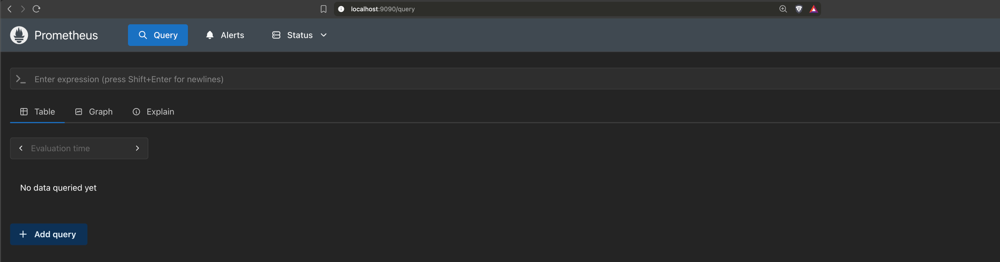

## Argo-Rollouts installation

`Argo-Rollouts` controller installation:

```bash
kubectl create namespace argo-rollouts
kubectl apply --server-side --force-conflicts -n argo-rollouts -f https://github.com/argoproj/argo-rollouts/releases/latest/download/install.yaml
```

**PS: It includes already the `CRDs`.**

## Rollout / Deployment creation

I'll be using `kustomize` and `kubeconform` to apply and lint the resources.

**Work with both will make it easier as well to template the same resources by just passing different `overlays` for both scenarios.**

The requirements for this step is to have at least the [`Argo-Rollouts` installation done first](#argo-rollouts-installation) as this depends on the `Rollout` CRD installation.

Checking the kustomize output with `kubeconform`:

**Ps: `kubeconform` needs the schema URL as below for `CRDs`.**

```bash
cd k8s-deployments/
kustomize build --load-restrictor LoadRestrictionsNone ./overlays/canary | kubeconform \
  -schema-location default \
  -schema-location 'https://raw.githubusercontent.com/datreeio/CRDs-catalog/main/{{.Group}}/{{.ResourceKind}}_{{.ResourceAPIVersion}}.json' \
  -strict -summary
```

```bash
Summary: 8 resources found parsing stdin - Valid: 8, Invalid: 0, Errors: 0, Skipped: 0
```

Appllying changes with kustomize (change the image tag): 

```bash
cd k8s-deployments/ 
kustomize edit --load-restrictor LoadRestrictionsNone ./overlays/canary set image <registry/image:tag>
kustomize build --load-restrictor LoadRestrictionsNone overlays/canary | kubectl apply -f -
```

If you want to clean all resources use the same `kustomize build` but with `delete` instead of `apply`:

```bash
cd k8s-deployments/
kustomize build --load-restrictor LoadRestrictionsNone overlays/canary | kubectl delete --force=true -f -
```

# Kustomize setup

This is the directory structure for managing the deployments with `kustomize` on this repository:

```text
k8s-deployments/
   ├─ overlays/                         - all patches / overwrites done by kustomize to the app-argo-rollouts.yaml
   │  └─ canary/                        - canary patches / overwrites
   │     ├─ cronjob-patch.yaml          - CronJob patch with the query and other aspects of the k8s CronJob
   │     ├─ kustomization.yaml          - main canary kustomization.yaml pointing to the patch files and main file
   │     └─ strategy-patch.yaml         - the canary strategy patch for the rollout
   └─ app-argo-rollouts.yaml            - main yaml with all resource definitions
```

This structure makes it simpler to change aspects of the resources, as for an example I'll be doing the same exercise for `blue-green` but with different customizations.

`Kustomize` is template free, not like `helm`, and it's simpler when dealing with resources you don't need to distribute.

You can use both though, like patch a 3rd party `helm chart` that lacks something you actually need.

But I didn't want any `full release` control of the resources in this case, just `argo-rollouts` controlling the rollouts is enough for this exercise.

I might return anyway in the future to make a `helm` chart, not for distribution but ony for the sacke of testing it together with `kustomize`.

More references: 

* <a href="https://kubectl.docs.kubernetes.io/references/kustomize/kustomization/helmcharts/" target="_blank">kustomize enable-helm</a>

# Canary

For the whole exercise to work, the `oha-loadtester` will constantly generate traffic with little gaps, or not gaps at all.

My plan of deployment is the following:

1. First rollout with stable version `v1.0.0`.
2. Let's do a new rollout setting the image to the new app `v2.0.0`.
    1. As it's a canary deployment we can see new pods for the new rollout brought up after each step of the rollout.
    2. Each step brings more pods up, and after step 2 it's when our `AnalysisTemplate` is triggered, but the condition is that more than just a single check of the metrics is done, so multiple failures have to show that the new deployment is actually slower than the previous one.
    3. Rollout here should be rolled back, as our `AnalysisTemplate` will fail, as our `SLO` will not hit the target, so new version is slower than the stable one.
3. Now it comes the fix with new tag `v2.0.1`, so a new image set for the app.
    1. Now the `SLO` will be better or equal to the version `v1.0.0`, so rollout should progress. 

**Ps: I'm not taking into consideration if the app had any changes in terms of features, that forces it to be changed, like a change on how the calculation does, and anyway in cases like this you can force `argo-rollouts` to anyway proceed with the rollout even though the analysis have failed.**

## AnalysisTamplate

In order for the rollouts to progress it has to pass the `AnalysisTemplate` called `latency`.

The analysis template is based on the `prometheus` metric `app_request_duration_seconds_bucket`:

```promql
sum(rate(app_request_duration_seconds_bucket{le="0.5",app="{{args.app-name}}",endpoint="{{args.predict-endpoint}}",rollouts_pod_template_hash="{{args.canary-hash}}"}[5m]))
/
sum(rate(app_request_duration_seconds_bucket{le="+Inf",app="{{args.app-name}}",endpoint="{{args.predict-endpoint}}",rollouts_pod_template_hash="{{args.canary-hash}}"}[5m]))
```

So here's what the query results:

* Analysis the min `SLO` for the new `canary-hash` rollout metrics for the `bucket` `le="0.5"`:
    * All requests should be below 0.5s or lower.
    * A decrease in `le="0.5"` can just mean fewer requests overall, so the absolute bucket rate isn't a reliable signal. What matters is the proportion of requests under a threshold. If `le="0.5"` drops while `le="+Inf"` doesn't, there are more executions above `0.5`.

Here's the main definition of the `AnalysisTemplate`:

```yaml
apiVersion: argoproj.io/v1alpha1
kind: AnalysisTemplate
metadata:
  name: latency
spec:
  args:
  - name: app-name
  - name: predict-endpoint
  - name: canary-hash
  metrics:
  - name: app_request_duration_seconds_bucket
    interval: 1m
    # NOTE: prometheus queries return results in the form of a vector.
    # So it is common to access the index 0 of the returned array to obtain the value
    successCondition: len(result) > 0 && result[0] >= 0.95
    failureLimit: 5 
    provider:
      prometheus:
        address: http://prometheus-server.prometheus.svc.cluster.local
        query: |
          sum(rate(app_request_duration_seconds_bucket{le="0.5",app="{{args.app-name}}",endpoint="{{args.predict-endpoint}}",rollouts_pod_template_hash="{{args.canary-hash}}"}[5m]))
          /
          sum(rate(app_request_duration_seconds_bucket{le="+Inf",app="{{args.app-name}}",endpoint="{{args.predict-endpoint}}",rollouts_pod_template_hash="{{args.canary-hash}}"}[5m]))
```

By he definition we see:
* The query and the whole defintion we described above for how he analysis is done and what's analyised.
* The `failureLimit` is set to 8, so failures < 9, rollouts won't progress.

**The same analysis does not run on the first rollout deployment, but you can run it as well by creating an `AnalysisRun` with the same definition, or create it from the analysis template.**

As an additonal test I've included an analysis template to check response status codes, so if we have responses with `5**`status it means that there's some issue with the rollout, so don't progress.

Here's the `AnalysisTemplate` defintion:


```yaml
apiVersion: argoproj.io/v1alpha1
kind: AnalysisTemplate
metadata:
  name: errors-new-rollout
spec:
  args:
  - name: app-name
  - name: predict-endpoint
  - name: canary-hash
  metrics:
  - name: app_http_requests_total
    interval: 1m
    successCondition: len(result) == 0 || result[0] == 0
    failureLimit: 5 
    provider:
      prometheus:
        address: http://prometheus-server.prometheus.svc.cluster.local
        query: |
          sum(rate(app_http_requests_total{status_code=~"5.*",app="{{args.app-name}}",endpoint="{{args.predict-endpoint}}",rollouts_pod_template_hash="{{args.canary-hash}}"}[5m])) or vector(0)
```

This template will be used as well for the `Blue-Green` rollout strategy. 

## Canary Tests

### First Revision

So now let's apply the first deployment, still image the image tag `v1.0.0`.

I've included as part of the first deployment an `AnalysisRun` to make sure that even on the first deployment we are not having requests above the `SLO` planned, so having most executiongs below `0.5s`.

I'll be using the `ArgoRollouts` dashboard to monitor the whole deployment, and let's wait at least until the first `AnalysisRun` finishes to start pushing new versions.

So for the first deployment we won't change the image at the [kustomization.yaml](./k8s-deployments/overlays/canary/kustimization.yaml) file.

**Ps: Good practice on each step is to run our validation above with `kubeconform` at each step, but you can skip now as the only change is the image tag.**

```bash
cd k8s-deployments
kustomize build --load-restrictor LoadRestrictionsNone overlays/canary | k apply -f -
```
Let's start the `ArgoRollouts` dashboard:

```bash
k argo rollouts dashboard
```
And then we get the output of the URL to access it:

```
INFO[0000] Argo Rollouts Dashboard is now available at http://localhost:3100/rollouts
```

Let's check if our first revision is deployed on the dashboard:

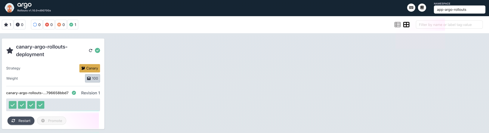

There are two initial `AnalysisRun` resources running at the first deployment. This is mainly to monitor now how the first deployment is running, but they are not tied to our `Rollout` resource though.

They are measuring the same as the `AnalysisTemplate`, but when deploying a first revision you don't have an analysis running.

We could have the command line running the an `AnalysisRun` from a `AnalysisTemplate`, and I'll do the command as well to check the new rollout.

Listing the `AnalysisRun` and the status:

```bash
k get analysisrun
NAME                            STATUS       AGE
canary-run-errors-new-rollout   Successful   12m
canary-run-latency              Successful   12m
```

We can see that both were successful, but let's check all status from it.

Let's check the details with `describe`:

```bash
k describe analysisrun canary-run-latency
```

You can check the full resource by yourself, so let me focus of the `Status`, as that's where we will see the results of the analysis:

```bash
Status:
  Completed At:  2026-11-02T09:53:43Z
  Dry Run Summary:
  Metric Results:
    Consecutive Success:  9
    Count:                10
    Failed:               1
    Measurements:
      Finished At:  2026-11-02T09:44:43Z
      Phase:        Failed
      Started At:   2026-11-02T09:44:43Z
      Value:        []
      Finished At:  2026-11-02T09:45:43Z
      Phase:        Successful
      Started At:   2026-11-02T09:45:43Z
      Value:        [1]
      Finished At:  2026-11-02T09:46:43Z
      Phase:        Successful
      Started At:   2026-11-02T09:46:43Z
      Value:        [1]
      Finished At:  2026-11-02T09:47:43Z
      Phase:        Successful
      Started At:   2026-11-02T09:47:43Z
      Value:        [1]
      Finished At:  2026-11-02T09:48:43Z
      Phase:        Successful
      Started At:   2026-11-02T09:48:43Z
      Value:        [1]
      Finished At:  2026-11-02T09:49:43Z
      Phase:        Successful
      Started At:   2026-11-02T09:49:43Z
      Value:        [1]
      Finished At:  2026-11-02T09:50:43Z
      Phase:        Successful
      Started At:   2026-11-02T09:50:43Z
      Value:        [1]
      Finished At:  2026-11-02T09:51:43Z
      Phase:        Successful
      Started At:   2026-11-02T09:51:43Z
      Value:        [1]
      Finished At:  2026-11-02T09:52:43Z
      Phase:        Successful
      Started At:   2026-11-02T09:52:43Z
      Value:        [1]
      Finished At:  2026-11-02T09:53:43Z
      Phase:        Successful
      Started At:   2026-11-02T09:53:43Z
      Value:        [1]
    Metadata:
      Resolved Prometheus Query:  sum(rate(app_request_duration_seconds_bucket{le="0.5",app="argo-rollouts-deployment",endpoint="predict"}[5m]))
/
sum(rate(app_request_duration_seconds_bucket{le="+Inf",app="argo-rollouts-deployment",endpoint="predict"}[5m]))

    Name:        app_request_duration_seconds_bucket
    Phase:       Successful
    Successful:  9
  Phase:         Successful
```

And we can see that our `SLO` is guarantee on the `AnalysisRun`, even though we had an initial failure, but most probably it was mainly due to the lack of metrics in prometheus.

Let's check the `canary-run-errors-new-rollout`:

```bash
Status:
  Completed At:  2026-11-02T09:50:42Z
  Dry Run Summary:
  Metric Results:
    Consecutive Success:  7
    Count:                7
    Measurements:
      Finished At:  2026-11-02T09:44:42Z
      Phase:        Successful
      Started At:   2026-11-02T09:44:42Z
      Value:        [0]
      Finished At:  2026-11-02T09:45:42Z
      Phase:        Successful
      Started At:   2026-11-02T09:45:42Z
      Value:        [0]
      Finished At:  2026-11-02T09:46:42Z
      Phase:        Successful
      Started At:   2026-11-02T09:46:42Z
      Value:        [0]
      Finished At:  2026-11-02T09:47:42Z
      Phase:        Successful
      Started At:   2026-11-02T09:47:42Z
      Value:        [0]
      Finished At:  2026-11-02T09:48:42Z
      Phase:        Successful
      Started At:   2026-11-02T09:48:42Z
      Value:        [0]
      Finished At:  2026-11-02T09:49:42Z
      Phase:        Successful
      Started At:   2026-11-02T09:49:42Z
      Value:        [0]
      Finished At:  2026-11-02T09:50:42Z
      Phase:        Successful
      Started At:   2026-11-02T09:50:42Z
      Value:        [0]
    Metadata:
      Resolved Prometheus Query:  sum(rate(app_http_requests_total{status_code=~"5.*",app="argo-rollouts-deployment",endpoint="predict"}[5m])) or vector(0)
```

We can see that we didn't have any errors as well on deployment the first rollout revision.

**Ps: The `AnalysisRun` here does not block the creation of the `Rollout`, like it blocks the progress of the version changes we will be showing later, but it could be used as a mechanism to monitor this first revision creation and check if it's healthy.**


Let's run one of the `AnalysisTemplate` as an `AnalysisRun` to check the command and check it's output:

```bash
k argo rollouts create analysisrun --from canary-latency \
    -a app-name=argo-rollouts-deployment \
    -a predict-endpoint=predict \
    -a canary-hash=796658bbd7
analysisrun.argoproj.io/canary-latency-bv8x6 created
```
As you can see in the command we can pass all the arguments needed to run it on the command line.

We can use both options in terms of CI/CD, create a more generic run, or just run a command and pass all arguments needed.

The values passed to create the `AnalysisRun` are the same passed when [patching](./k8s-deployments/overlays/canary/strategy-patch.yaml) the strategy for the rollout.

The `canary-hash` value is the new hash generated for this first rollout revision, and you can check it on the `argo-rollouts` dashboard, or checking the rollout on the command line:

```bash
k argo rollouts list rollout
```

```bash
NAME                             STRATEGY   STATUS        STEP  SET-WEIGHT  READY  DESIRED  UP-TO-DATE  AVAILABLE
canary-argo-rollouts-deployment  Canary     Healthy       8/8   100         4/4    4        4           4
```

```bash
k argo rollouts get rollout canary-argo-rollouts-deployment
```

```bash
Name:            canary-argo-rollouts-deployment
Namespace:       app-argo-rollouts
Status:          ✔ Healthy
Strategy:        Canary
  Step:          8/8
  SetWeight:     100
  ActualWeight:  100
Images:          localhost/app-argo-rollouts:v1.0.0 (stable)
Replicas:
  Desired:       4
  Current:       4
  Updated:       4
  Ready:         4
  Available:     4

NAME                                                         KIND        STATUS     AGE  INFO
⟳ canary-argo-rollouts-deployment                            Rollout     ✔ Healthy  39m
└──# revision:1
   └──⧉ canary-argo-rollouts-deployment-796658bbd7           ReplicaSet  ✔ Healthy  39m  stable
      ├──□ canary-argo-rollouts-deployment-796658bbd7-9bwrn  Pod         ✔ Running  39m  ready:1/1
      ├──□ canary-argo-rollouts-deployment-796658bbd7-d7lwr  Pod         ✔ Running  39m  ready:1/1
      ├──□ canary-argo-rollouts-deployment-796658bbd7-kwdkc  Pod         ✔ Running  39m  ready:1/1
      └──□ canary-argo-rollouts-deployment-796658bbd7-w64pw  Pod         ✔ Running  39m  ready:1/1
```

So our hash is `796658bbd7`.

Let's list and describe the new run and check the results.

```bash
k get analysisruns.argoproj.io
NAME                            STATUS       AGE
canary-latency-bv8x6            Running      8m13s
canary-run-errors-new-rollout   Successful   36m
canary-run-latency              Successful   36m
```

```bash
Name:         canary-latency-bv8x6
Namespace:    app-argo-rollouts
Labels:       <none>
Annotations:  <none>
API Version:  argoproj.io/v1alpha1
Kind:         AnalysisRun
Metadata:
  Creation Timestamp:  2026-11-02T10:12:07Z
  Generate Name:       canary-latency-
  Generation:          11
  Resource Version:    2427302
  UID:                 68bd10fb-23c5-4fa9-b611-26f74dcce73f
Spec:
  Args:
    Name:   app-name
    Value:  argo-rollouts-deployment
    Name:   predict-endpoint
    Value:  predict
    Name:   canary-hash
    Value:  796658bbd7
  Metrics:
    Failure Limit:  5
    Interval:       1m
    Name:           app_request_duration_seconds_bucket
    Provider:
      Prometheus:
        Address:  http://prometheus-server.prometheus.svc.cluster.local
        Query:    sum(rate(app_request_duration_seconds_bucket{le="0.5",app="{{args.app-name}}",endpoint="{{args.predict-endpoint}}",rollouts_pod_template_hash="{{args.canary-hash}}"}[5m]))
/
sum(rate(app_request_duration_seconds_bucket{le="+Inf",app="{{args.app-name}}",endpoint="{{args.predict-endpoint}}",rollouts_pod_template_hash="{{args.canary-hash}}"}[5m]))

    Success Condition:  len(result) > 0 && result[0] >= 0.95
Status:
  Dry Run Summary:
  Metric Results:
    Consecutive Success:  10
    Count:                10
    Measurements:
      Finished At:  2026-11-02T10:12:07Z
      Phase:        Successful
      Started At:   2026-11-02T10:12:07Z
      Value:        [1]
      Finished At:  2026-11-02T10:13:07Z
      Phase:        Successful
      Started At:   2026-11-02T10:13:07Z
      Value:        [1]
      Finished At:  2026-11-02T10:14:07Z
      Phase:        Successful
      Started At:   2026-11-02T10:14:07Z
      Value:        [1]
      Finished At:  2026-11-02T10:15:07Z
      Phase:        Successful
      Started At:   2026-11-02T10:15:07Z
      Value:        [1]
      Finished At:  2026-11-02T10:16:07Z
      Phase:        Successful
      Started At:   2026-11-02T10:16:07Z
      Value:        [1]
      Finished At:  2026-11-02T10:17:07Z
      Phase:        Successful
      Started At:   2026-11-02T10:17:07Z
      Value:        [1]
      Finished At:  2026-11-02T10:18:07Z
      Phase:        Successful
      Started At:   2026-11-02T10:18:07Z
      Value:        [1]
      Finished At:  2026-11-02T10:19:07Z
      Phase:        Successful
      Started At:   2026-11-02T10:19:07Z
      Value:        [1]
      Finished At:  2026-11-02T10:20:07Z
      Phase:        Successful
      Started At:   2026-11-02T10:20:07Z
      Value:        [1]
      Finished At:  2026-11-02T10:21:07Z
      Phase:        Successful
      Started At:   2026-11-02T10:21:07Z
      Value:        [1]
    Metadata:
      Resolved Prometheus Query:  sum(rate(app_request_duration_seconds_bucket{le="0.5",app="argo-rollouts-deployment",endpoint="predict",rollouts_pod_template_hash="796658bbd7"}[5m]))
/
sum(rate(app_request_duration_seconds_bucket{le="+Inf",app="argo-rollouts-deployment",endpoint="predict",rollouts_pod_template_hash="796658bbd7"}[5m]))

    Name:        app_request_duration_seconds_bucket
    Phase:       Running
    Successful:  10
  Phase:         Running
  Run Summary:
    Count:     1
  Started At:  2026-11-02T10:12:07Z
Events:        <none>
```

As the run now is not tied to a rollout process, and it does not have count, we have to stop it manually:

```bash
k argo rollouts terminate analysisrun canary-latency-bv8x6
```

```bash
➜  k8s-deployments git:(main) ✗ k argo rollouts terminate analysisrun canary-latency-bv8x6

analysisRun 'canary-latency-bv8x6' terminated
```

```bash
k get analysisruns.argoproj.io
NAME                            STATUS       AGE
canary-latency-bv8x6            Successful   16m
canary-run-errors-new-rollout   Successful   44m
canary-run-latency              Successful   44m
```

### Second revision

Let's now progress with the versioning, so we have a new app version.

So now the rollout will run both `AnalysisTemplate`, and mark if it's successful or not and then allowing the progress of the rollout or not.

Just to recapitulate, for version `v2.0.0` I've included a `time.sleep` in the endpoint, so it will harm our `SLO` for the new version.

There won't be any errors though, so no `5**` responses.

Let's first patch the deployment with `kustomize` by editing our image and tag:

```bash
cd ./k8s-deployments/overlays/canary
kustomize edit set image app-argo-rollouts=localhost/app-argo-rollouts:v2.0.0
```

**Ps: Go back to the directory `k8s-deployments` before running further commands. In order to run the `kustomize edit` command we have to unfortunately navigate to the `kustomization.yaml` file.**

Let's check if it's all still valid for pushing the changes with `kustomize`:

```bash
kustomize build --load-restrictor LoadRestrictionsNone ./overlays/canary | kubeconform \
  -schema-location default \
  -schema-location 'https://raw.githubusercontent.com/datreeio/CRDs-catalog/main/{{.Group}}/{{.ResourceKind}}_{{.ResourceAPIVersion}}.json' \
  -strict -summary
Summary: 8 resources found parsing stdin - Valid: 8, Invalid: 0, Errors: 0, Skipped: 0
```

Let's run the new rollout now:

```bash
kustomize build --load-restrictor LoadRestrictionsNone overlays/canary | k apply -f -
```

Let's check it with the command line as well:

```bash
k argo rollouts get rollout canary-argo-rollouts-deployment
Name:            canary-argo-rollouts-deployment
Namespace:       app-argo-rollouts
Status:          ॥ Paused
Message:         CanaryPauseStep
Strategy:        Canary
  Step:          1/8
  SetWeight:     20
  ActualWeight:  20
Images:          localhost/app-argo-rollouts:v1.0.0 (stable)
                 localhost/app-argo-rollouts:v2.0.0 (canary)
Replicas:
  Desired:       4
  Current:       5
  Updated:       1
  Ready:         5
  Available:     5

NAME                                                         KIND        STATUS     AGE    INFO
⟳ canary-argo-rollouts-deployment                            Rollout     ॥ Paused   68m
├──# revision:2
│  └──⧉ canary-argo-rollouts-deployment-7fbf7c56d4           ReplicaSet  ✔ Healthy  8m16s  canary
│     └──□ canary-argo-rollouts-deployment-7fbf7c56d4-7qfvq  Pod         ✔ Running  8m16s  ready:1/1
└──# revision:1
   └──⧉ canary-argo-rollouts-deployment-796658bbd7           ReplicaSet  ✔ Healthy  68m    stable
      ├──□ canary-argo-rollouts-deployment-796658bbd7-9bwrn  Pod         ✔ Running  68m    ready:1/1
      ├──□ canary-argo-rollouts-deployment-796658bbd7-d7lwr  Pod         ✔ Running  68m    ready:1/1
      ├──□ canary-argo-rollouts-deployment-796658bbd7-kwdkc  Pod         ✔ Running  68m    ready:1/1
      └──□ canary-argo-rollouts-deployment-796658bbd7-w64pw  Pod         ✔ Running  68m    ready:1/1
```

We will see the steps on the rollout and it's pauses, and we will be able to see the `AnalysisTemplate` being triggered at the step `2`.

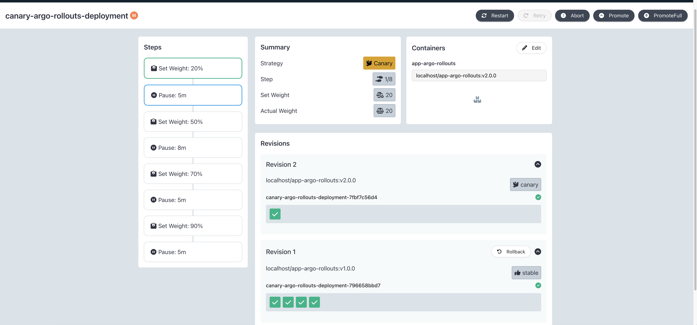

As you can check on the strategy patch for canary, we are progressing the number of instances on the new revision at each step.

The pauses are important between the steps, as with this we have guarantee, and enough metrics collected, to run our `AnalysisTemplate` checks.

On reaching the step 2 now we see the `AnalysisTemplate` running:

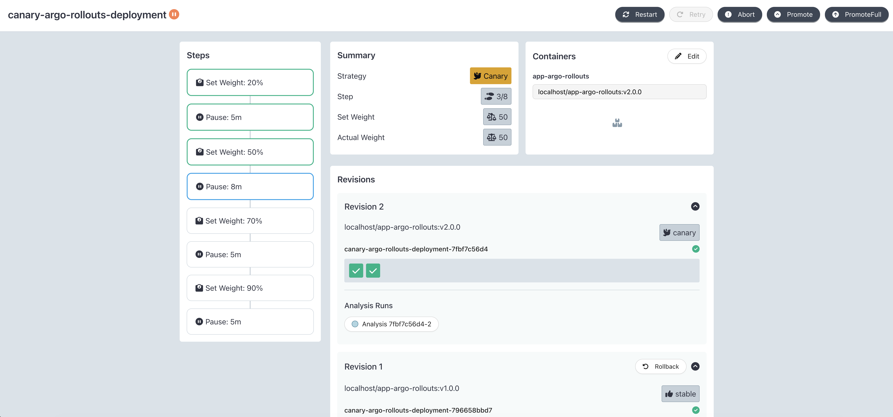

And we can check the detailed information for the analysis as well:

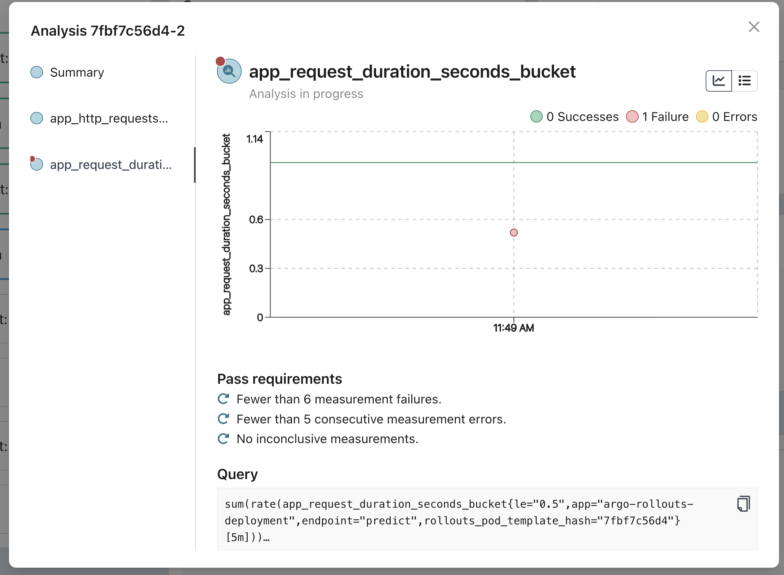

We've set intervals on both analysis to collect the metrics and do the analysis, so let's see how it will go with the new revision after all metrics are collected and if we the revision will be allowed to progress.

After the analysis it seems that our revison won't progress:

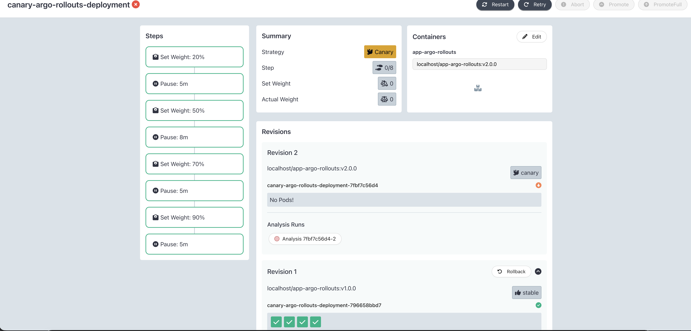

Let's see the metrics points collected and check why it didn't progress.

For the `http errors` we have the following:

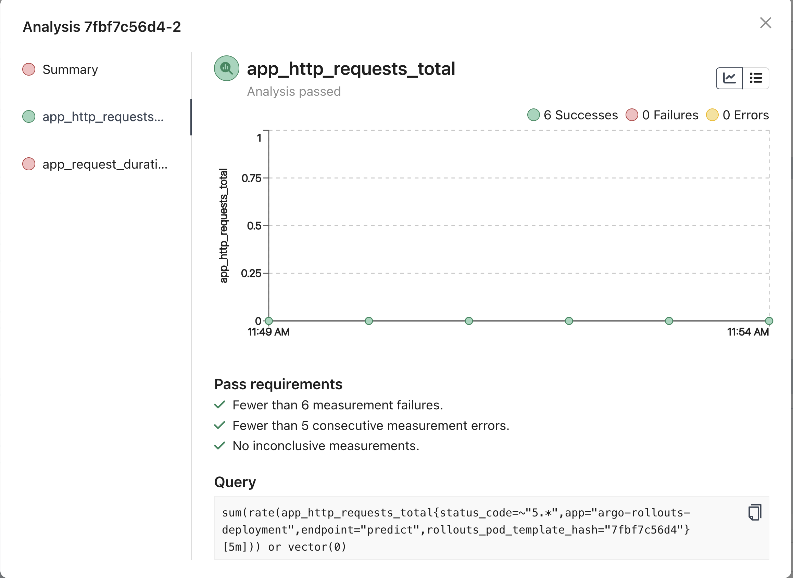

We can see that we had to failures, what's expected.

For the `SLO`, or latency analysis:

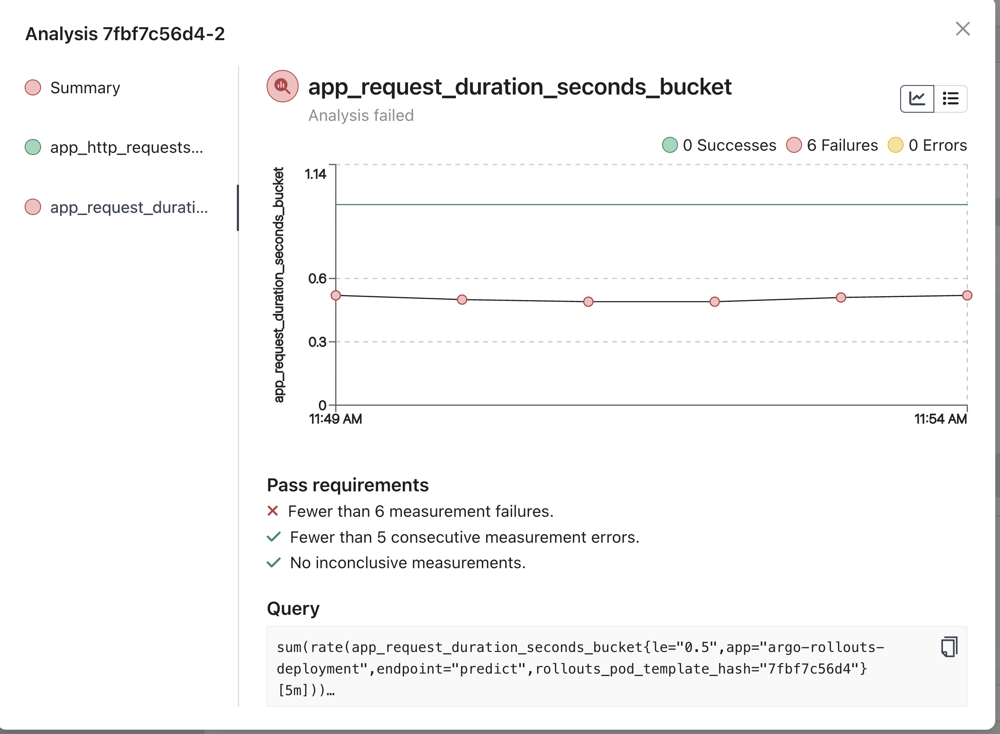

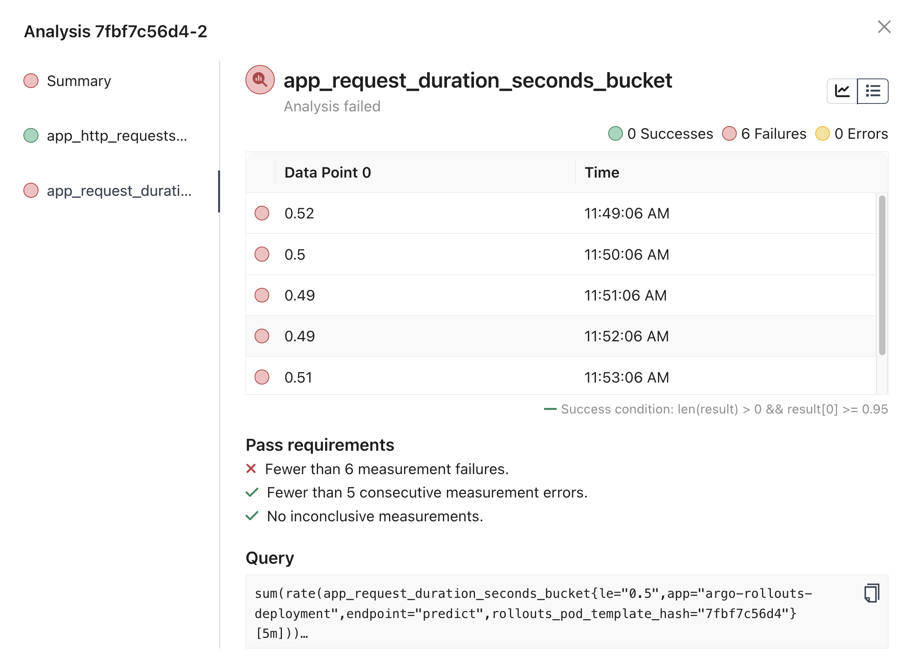

As expected as well our analysis here failed, and the rollouts didn't progress with the new image version.

Of course we could force it to progress if we think that even with the negative analysis it won't cause a big impact, but let's keep it with the old version for our exercise.

**Ps: Recapituliting again, the failure here is because of the `time.Sleep` we added in the endpoint for version `v2.0.0`. 

### Third Revision

So now we will try to rollout a patch that fixed version `v2.0.0`, with version `v2.0.1`.

Let's do the same process by editing the image again and deploying again our rollout:

```bash
can ./k8s-deployments/overlays/canary
kustomize edit set image app-argo-rollouts=localhost/app-argo-rollouts:v2.0.1
```

Checking if it's all valid:

```bash
kustomize build --load-restrictor LoadRestrictionsNone ./overlays/canary | kubeconform \
  -schema-location default \
  -schema-location 'https://raw.githubusercontent.com/datreeio/CRDs-catalog/main/{{.Group}}/{{.ResourceKind}}_{{.ResourceAPIVersion}}.json' \
  -strict -summary

Summary: 8 resources found parsing stdin - Valid: 8, Invalid: 0, Errors: 0, Skipped: 0
```

And deploying the new rollout:

```bash
kustomize build --load-restrictor LoadRestrictionsNone overlays/canary | k apply -f -
```

```bash
k argo rollouts get rollout canary-argo-rollouts-deployment
Name:            canary-argo-rollouts-deployment
Namespace:       app-argo-rollouts
Status:          ॥ Paused
Message:         CanaryPauseStep
Strategy:        Canary
  Step:          1/8
  SetWeight:     20
  ActualWeight:  20
Images:          localhost/app-argo-rollouts:v1.0.0 (stable)
                 localhost/app-argo-rollouts:v2.0.1 (canary)
Replicas:
  Desired:       4
  Current:       5
  Updated:       1
  Ready:         5
  Available:     5

NAME                                                         KIND         STATUS        AGE    INFO
⟳ canary-argo-rollouts-deployment                            Rollout      ॥ Paused      87m
├──# revision:3
│  └──⧉ canary-argo-rollouts-deployment-6dfb49d477           ReplicaSet   ✔ Healthy     5m38s  canary
│     └──□ canary-argo-rollouts-deployment-6dfb49d477-2vpg2  Pod          ✔ Running     5m38s  ready:1/1
├──# revision:2
│  ├──⧉ canary-argo-rollouts-deployment-7fbf7c56d4           ReplicaSet   • ScaledDown  27m
│  └──α canary-argo-rollouts-deployment-7fbf7c56d4-2         AnalysisRun  ✖ Failed      22m    ✔ 6,✖ 6
└──# revision:1
   └──⧉ canary-argo-rollouts-deployment-796658bbd7           ReplicaSet   ✔ Healthy     87m    stable
      ├──□ canary-argo-rollouts-deployment-796658bbd7-9bwrn  Pod          ✔ Running     87m    ready:1/1
      ├──□ canary-argo-rollouts-deployment-796658bbd7-d7lwr  Pod          ✔ Running     87m    ready:1/1
      ├──□ canary-argo-rollouts-deployment-796658bbd7-6dc9r  Pod          ✔ Running     17m    ready:1/1
      └──□ canary-argo-rollouts-deployment-796658bbd7-fz75v  Pod          ✔ Running     17m    ready:1/1
```

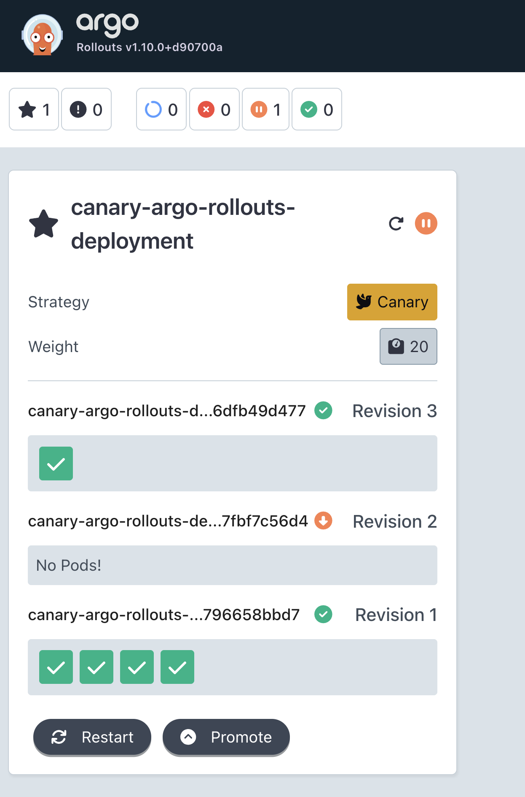

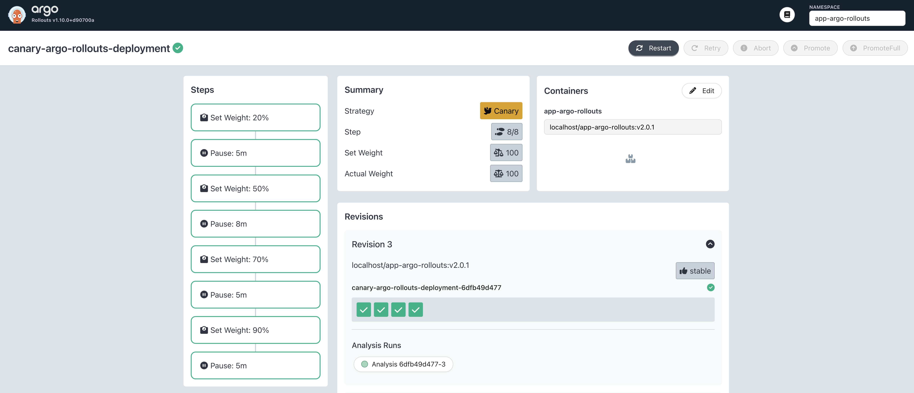

We have to now wait for the analysis to start on step 2, and see the results.

And it's now starting the analysis, and it looks promising, let's see if it passes and if it becomes the latest version.

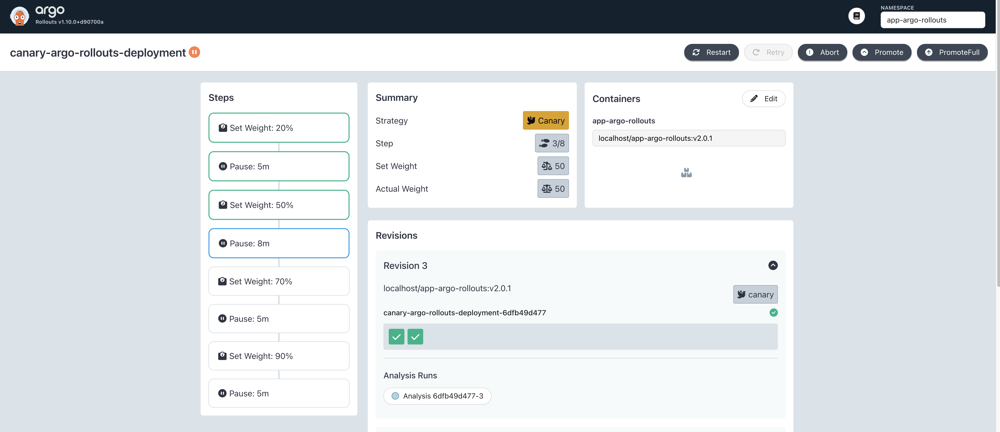

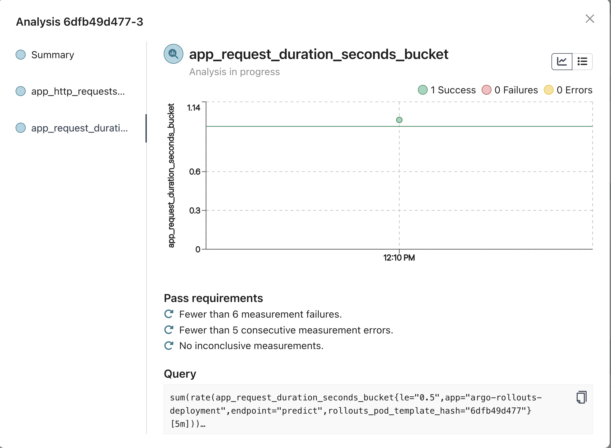

After the analysis we see now that our new rollout progressed, so we have our new image version deployed as the latest revision.

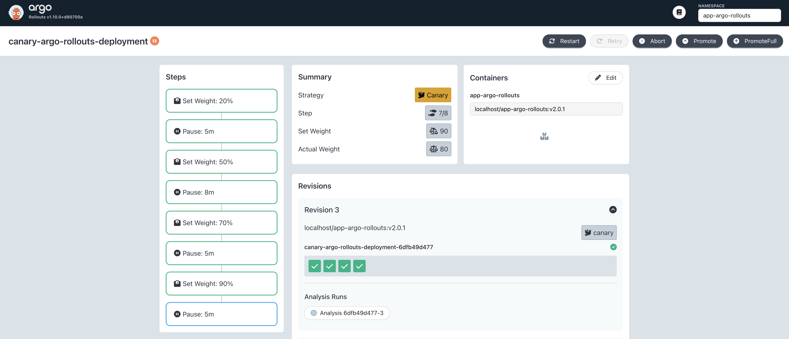

```bash
k argo rollouts get rollout canary-argo-rollouts-deployment
Name:            canary-argo-rollouts-deployment
Namespace:       app-argo-rollouts
Status:          ॥ Paused
Message:         CanaryPauseStep
Strategy:        Canary
  Step:          7/8
  SetWeight:     90
  ActualWeight:  80
Images:          localhost/app-argo-rollouts:v1.0.0 (stable)
                 localhost/app-argo-rollouts:v2.0.1 (canary)
Replicas:
  Desired:       4
  Current:       5
  Updated:       4
  Ready:         5
  Available:     5

NAME                                                         KIND         STATUS        AGE   INFO
⟳ canary-argo-rollouts-deployment                            Rollout      ॥ Paused      107m
├──# revision:3
│  ├──⧉ canary-argo-rollouts-deployment-6dfb49d477           ReplicaSet   ✔ Healthy     25m   canary
│  │  ├──□ canary-argo-rollouts-deployment-6dfb49d477-2vpg2  Pod          ✔ Running     25m   ready:1/1
│  │  ├──□ canary-argo-rollouts-deployment-6dfb49d477-gjcp6  Pod          ✔ Running     20m   ready:1/1
│  │  ├──□ canary-argo-rollouts-deployment-6dfb49d477-87j2k  Pod          ✔ Running     12m   ready:1/1
│  │  └──□ canary-argo-rollouts-deployment-6dfb49d477-qw2hv  Pod          ✔ Running     7m    ready:1/1
│  └──α canary-argo-rollouts-deployment-6dfb49d477-3         AnalysisRun  ◌ Running     20m   ✔ 30
├──# revision:2
│  ├──⧉ canary-argo-rollouts-deployment-7fbf7c56d4           ReplicaSet   • ScaledDown  46m
│  └──α canary-argo-rollouts-deployment-7fbf7c56d4-2         AnalysisRun  ✖ Failed      41m   ✔ 6,✖ 6
└──# revision:1
   └──⧉ canary-argo-rollouts-deployment-796658bbd7           ReplicaSet   ✔ Healthy     107m  stable
      └──□ canary-argo-rollouts-deployment-796658bbd7-d7lwr  Pod          ✔ Running     107m  ready:1/1
```
And finally revision 3 is now the stable one, ot latest.


```bash
k argo rollouts get rollout canary-argo-rollouts-deployment
Name:            canary-argo-rollouts-deployment
Namespace:       app-argo-rollouts
Status:          ✔ Healthy
Strategy:        Canary
  Step:          8/8
  SetWeight:     100
  ActualWeight:  100
Images:          localhost/app-argo-rollouts:v2.0.1 (stable)
Replicas:
  Desired:       4
  Current:       4
  Updated:       4
  Ready:         4
  Available:     4

NAME                                                         KIND         STATUS        AGE   INFO
⟳ canary-argo-rollouts-deployment                            Rollout      ✔ Healthy     112m
├──# revision:3
│  ├──⧉ canary-argo-rollouts-deployment-6dfb49d477           ReplicaSet   ✔ Healthy     29m   stable
│  │  ├──□ canary-argo-rollouts-deployment-6dfb49d477-2vpg2  Pod          ✔ Running     29m   ready:1/1
│  │  ├──□ canary-argo-rollouts-deployment-6dfb49d477-gjcp6  Pod          ✔ Running     24m   ready:1/1
│  │  ├──□ canary-argo-rollouts-deployment-6dfb49d477-87j2k  Pod          ✔ Running     16m   ready:1/1
│  │  └──□ canary-argo-rollouts-deployment-6dfb49d477-qw2hv  Pod          ✔ Running     11m   ready:1/1
│  └──α canary-argo-rollouts-deployment-6dfb49d477-3         AnalysisRun  ✔ Successful  24m   ✔ 38
├──# revision:2
│  ├──⧉ canary-argo-rollouts-deployment-7fbf7c56d4           ReplicaSet   • ScaledDown  51m
│  └──α canary-argo-rollouts-deployment-7fbf7c56d4-2         AnalysisRun  ✖ Failed      46m   ✔ 6,✖ 6
└──# revision:1
   └──⧉ canary-argo-rollouts-deployment-796658bbd7           ReplicaSet   • ScaledDown  112m
```

### Cleaning up the rollout and deployments

As explained before, we can still use `kustomize` and `kubectl` to do the clean up:

```bash
cd k8s-deployments/
kustomize build --load-restrictor LoadRestrictionsNone overlays/canary | k delete --force=true -f -
```

# Blue-Green

`TODO`
